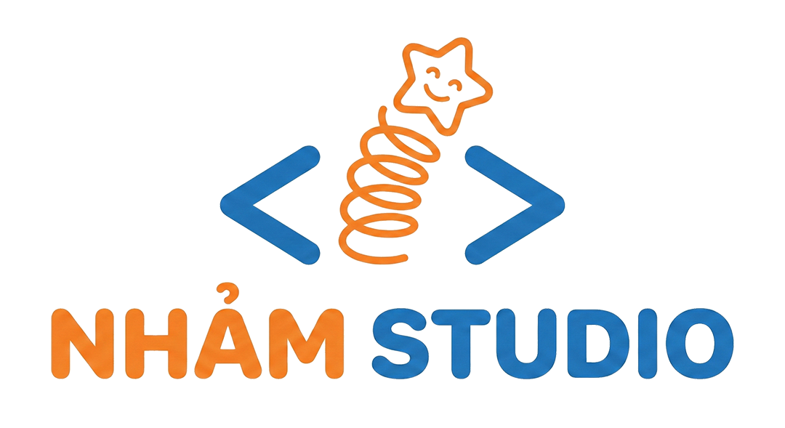
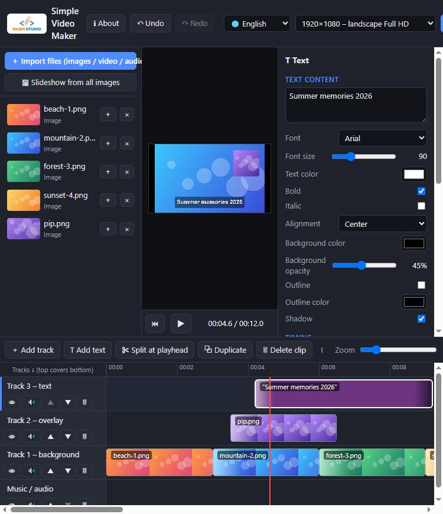
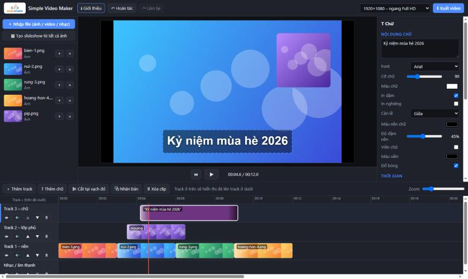

<a name="english"></a>
<p align="center">
  
</p>

<h1 align="center">Simple Video Maker</h1>

<p align="center">
  <b>English</b> · <a href="#tieng-viet">Tiếng Việt</a>
</p>

<p align="center">
  A <b>simple, free, in-browser</b> video maker.<br>
  Combine images, videos, music and text into an MP4 with drag & drop. No install, no account.
</p>

<p align="center">
  <a href="https://topvl.net">🌐 topvl.net</a> · Developed by <b>NhảmStudio</b>
</p>

---



## ✨ Features

- **Drag & drop** images, videos and music onto the timeline (from the library or straight from your file explorer).
- **Multiple tracks (layers)**: upper tracks are drawn on top of lower ones. A layer that does not cover the whole frame lets the layers below show through (picture-in-picture, logos, captions…).
- **Automatic transitions** between images placed back-to-back on the same track. 8 styles: fade, slide (4 directions), zoom, wipe, circle reveal.
- **One-click slideshow** from every image in the library.
- **Text**: font, size, color, bold/italic, background box, outline, shadow, alignment, entrance/exit effects.
- **Image motion** (Ken Burns effect): slow zoom in/out, pan left/right.
- **Visual editing** in the preview: drag to move, scroll to resize. Also corner radius, opacity and frame mode (fit, fill, stretch).
- **Audio**: per-clip volume, fade in/out, mute per track.
- **Split, duplicate and trim clips**, with snapping to clip edges and the playhead.
- **Undo / redo** (up to 150 steps).
- **Several frame sizes**: 16:9 (720p, 1080p, 4K), 9:16 portrait (TikTok/Reels/Shorts), 1:1 square.
- **MP4 export** (H.264 + AAC) in Chrome/Edge at high quality (16 Mbps at 1080p).
- **Bilingual UI**: English (default) and Vietnamese, switchable from the header. Your choice is remembered.

## 🔒 Privacy

Everything runs **inside the user's browser**:

- Images, videos and music are **never uploaded** to any server.
- The exported video is saved **directly to the user's computer** (Downloads folder).
- The server only serves one static HTML file, so it uses almost no resources.

## 🚀 Getting started

### Run locally (offline)

1. Download this repo (or just `index.html`).
2. Double-click `index.html` to open it in **Google Chrome** or **Microsoft Edge**.

> `index.html` is a single self-contained file with the logo embedded. The `assets/` folder is only used by this README.

### Host on a web server / VPS

Put `index.html` in your web root. Example **nginx** config:

```nginx
server {
    listen 80;
    server_name video.example.com;
    root /var/www/videomaker;
    index index.html;
}
```

It also works on **GitHub Pages**, Netlify, Vercel, Cloudflare Pages, or any other static host. Enabling **HTTPS** is recommended.

## 📖 Quick guide

1. Click **＋ Import files** to add images, videos and music to the library on the left.
2. **Drag** a file onto a timeline track, or click **＋** to append it to the selected track.
3. Place several images back-to-back on one track to get **automatic transitions**. Change the style in the right panel.
4. To layer things (a small video in a corner, a logo, captions), put the clip on an **upper track**, then resize or move it in the preview.
5. Click **T Add text** to add text at the red playhead.
6. Click any clip to edit its properties in the right panel.
7. Click **⬇ Export video** to save an MP4.

### Timeline actions

| Action | How |
|---|---|
| Move a clip | Drag its body (also onto another track) |
| Change length / trim | Drag the clip's left or right edge |
| Seek | Click the time ruler or an empty spot on a track |
| Zoom the timeline | Zoom slider or `Ctrl` + scroll |
| Reorder layers | ▲ ▼ buttons on each track header |

### Keyboard shortcuts

| Key | Action |
|---|---|
| `Space` | Play / pause |
| `Delete` | Delete the selected clip |
| `S` | Split the clip at the playhead |
| `Ctrl + D` | Duplicate the clip |
| `Ctrl + Z` / `Ctrl + Y` | Undo / redo |
| `←` `→` (hold `Shift` for 5 s) | Seek |
| `Home` | Go to start |

## 🌐 Browser support

| Browser | Support | Export format |
|---|---|---|
| Google Chrome (recent) | ✅ Recommended | MP4 |
| Microsoft Edge (recent) | ✅ Recommended | MP4 |
| Firefox | ❓ Not tested | WebM (expected) |
| Safari | ❓ Not tested | – |

## ⚠️ Known limitations

- **Real-time export**: a 2-minute video takes about 2 minutes to export. **Keep the tab visible** while exporting (do not minimize the window or switch tabs).
- **No project save/load yet**: reloading the page loses the current project (the page warns you before closing).
- Preview and export speed depend on the user's computer.
- Supported input formats depend on the browser. Some `.mov` / `.mkv` files or HEVC/H.265 videos may not open.

## 🛠 Tech

- Plain HTML + CSS + JavaScript. **No dependencies, no build step.**
- Canvas 2D for rendering, Web Audio API for mixing, MediaRecorder for export.

## 👨‍💻 Author

**NhảmStudio** – [https://topvl.net](https://topvl.net)

Feedback and bug reports are welcome in **Issues**.

---
---

<a name="tieng-viet"></a>
<h2 align="center">🇻🇳 Tiếng Việt</h2>

<p align="center">
  <a href="#english">English</a> · <b>Tiếng Việt</b>
</p>

<p align="center">
  Công cụ làm video <b>đơn giản, miễn phí, chạy ngay trên trình duyệt</b>.<br>
  Ghép ảnh, video, nhạc, chữ thành video MP4 chỉ bằng kéo thả. Không cần cài đặt, không cần tài khoản.
</p>



### ✨ Tính năng

- **Kéo thả** ảnh, video, nhạc vào timeline (từ thư viện hoặc kéo thẳng từ thư mục máy tính).
- **Nhiều track (lớp)**: track ở trên hiển thị đè lên track ở dưới. Lớp nào không phủ hết khung hình thì vẫn thấy lớp bên dưới (picture-in-picture, logo, khung chữ…).
- **Chuyển cảnh tự động** khi đặt nhiều ảnh liền nhau trên cùng một track. Có 8 kiểu: mờ dần, trượt 4 hướng, zoom, quét ngang, vòng tròn.
- **Tạo slideshow 1 click** từ toàn bộ ảnh trong thư viện.
- **Chữ (text)**: font, cỡ, màu, in đậm/nghiêng, nền chữ, viền, đổ bóng, căn lề, hiệu ứng xuất hiện/biến mất.
- **Chuyển động cho ảnh** (hiệu ứng Ken Burns): zoom chậm vào/ra, lia trái/phải.
- **Chỉnh trực quan** trong khung xem trước: kéo để di chuyển, lăn chuột để phóng to/thu nhỏ. Có thêm bo góc, độ trong suốt, kiểu khung (vừa khung, phủ kín, kéo giãn).
- **Âm thanh**: chỉnh âm lượng từng clip, tăng/giảm dần âm lượng, tắt tiếng từng track.
- **Cắt, nhân bản, kéo dài/thu ngắn clip**, tự bám (snap) vào mép clip khác và vạch phát.
- **Hoàn tác / làm lại** (tối đa 150 bước).
- **Nhiều khung hình**: 16:9 (720p, 1080p, 4K), dọc 9:16 (TikTok/Reels/Shorts), vuông 1:1.
- **Xuất video MP4** (H.264 + AAC) trên Chrome/Edge, chất lượng cao (16 Mbps ở 1080p).
- **Giao diện song ngữ**: tiếng Anh (mặc định) và tiếng Việt, đổi ở thanh trên cùng. Lựa chọn được ghi nhớ cho lần sau.

### 🔒 Riêng tư

Mọi xử lý đều diễn ra **trong trình duyệt của người dùng**:

- Ảnh, video, nhạc **không bao giờ bị tải lên server**.
- File video xuất ra được lưu **thẳng vào máy người dùng** (thư mục Downloads).
- Server chỉ phục vụ một file HTML tĩnh, nên gần như không tốn tài nguyên.

### 🚀 Sử dụng

**Chạy trên máy (offline):** tải repo về (hoặc chỉ cần file `index.html`), rồi bấm đúp để mở bằng **Google Chrome** hoặc **Microsoft Edge**.

> `index.html` là một file duy nhất, logo đã được nhúng sẵn bên trong. Thư mục `assets/` chỉ dùng cho README.

**Đưa lên web server / VPS:** chỉ cần đặt `index.html` vào thư mục web (xem ví dụ cấu hình nginx ở phần tiếng Anh phía trên). Cũng chạy được trên **GitHub Pages**, Netlify, Vercel, Cloudflare Pages… Khuyến nghị bật **HTTPS**.

### 📖 Hướng dẫn nhanh

1. Bấm **＋ Nhập file** để thêm ảnh, video, nhạc vào thư viện bên trái.
2. **Kéo** file xuống một track trên timeline, hoặc bấm **＋** để thêm vào cuối track đang chọn.
3. Đặt nhiều ảnh liền nhau trên cùng track để có **hiệu ứng chuyển ảnh** tự động. Có thể đổi kiểu ở bảng bên phải.
4. Muốn chồng lớp (ví dụ video nhỏ ở góc, logo, chữ): đặt clip vào **track phía trên**, rồi thu nhỏ hoặc di chuyển nó trong khung xem trước.
5. Bấm **T Thêm chữ** để thêm chữ tại vạch đỏ.
6. Bấm vào clip bất kỳ để chỉnh thuộc tính ở bảng bên phải.
7. Bấm **⬇ Xuất video** để lưu file MP4.

| Thao tác | Cách làm |
|---|---|
| Di chuyển clip | Kéo thân clip (có thể kéo sang track khác) |
| Đổi độ dài / cắt đầu, cuối | Kéo mép trái / mép phải của clip |
| Tua | Bấm vào thước thời gian hoặc vùng trống của track |
| Zoom timeline | Thanh Zoom hoặc `Ctrl` + lăn chuột |
| Đổi thứ tự lớp | Nút ▲ ▼ ở đầu mỗi track |

| Phím | Chức năng |
|---|---|
| `Space` | Phát / dừng |
| `Delete` | Xóa clip đang chọn |
| `S` | Cắt clip tại vạch đỏ |
| `Ctrl + D` | Nhân bản clip |
| `Ctrl + Z` / `Ctrl + Y` | Hoàn tác / làm lại |
| `←` `→` (giữ `Shift` để tua 5 giây) | Tua |
| `Home` | Về đầu video |

### 🌐 Trình duyệt hỗ trợ

| Trình duyệt | Hỗ trợ | Định dạng xuất |
|---|---|---|
| Google Chrome (bản mới) | ✅ Khuyên dùng | MP4 |
| Microsoft Edge (bản mới) | ✅ Khuyên dùng | MP4 |
| Firefox | ❓ Chưa kiểm thử | WebM (dự kiến) |
| Safari | ❓ Chưa kiểm thử | – |

### ⚠️ Hạn chế hiện tại

- **Xuất theo thời gian thực**: video dài 2 phút thì mất khoảng 2 phút để xuất. Trong lúc xuất hãy **giữ tab đang hiển thị** (không thu nhỏ cửa sổ hoặc chuyển tab).
- **Chưa có lưu/mở dự án**: tải lại trang sẽ mất dự án đang làm (trang có cảnh báo trước khi đóng).
- Tốc độ xem trước và xuất phụ thuộc cấu hình máy người dùng.
- Định dạng file đầu vào phụ thuộc trình duyệt. Ví dụ một số file `.mov`, `.mkv` hoặc codec HEVC/H.265 có thể không mở được.

### 🛠 Công nghệ

- HTML + CSS + JavaScript thuần, **không dùng thư viện ngoài, không cần build**.
- Canvas 2D để dựng hình, Web Audio API để trộn âm thanh, MediaRecorder để xuất video.

### 👨‍💻 Tác giả

**NhảmStudio** – [https://topvl.net](https://topvl.net)

Mọi góp ý, báo lỗi xin gửi qua mục **Issues** của repo.
